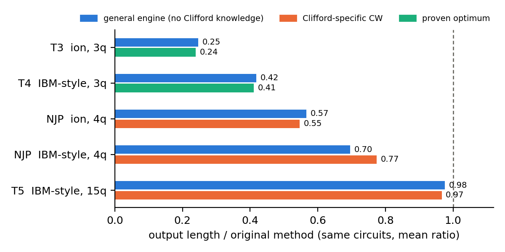

# qcr: quantum circuit reduction, made exact

[](https://github.com/arnavk23/qcr/actions/workflows/ci.yml)
[](LICENSE)
[](pyproject.toml)
[](docs/index.rst)
[](https://github.com/astral-sh/ruff)
[](https://arxiv.org/abs/2502.14715)

**qcr** is a Python library and research codebase for *local rewriting* of quantum circuits: repeatedly
replacing a small sub-circuit with a cheaper equivalent one taken from a precomputed database. It started as a
reproduction of Rosenhahn, Osborne & Hirche, *Optimization driven quantum circuit reduction*
([New J. Phys. 27, 104509 (2025)](https://arxiv.org/abs/2502.14715)), and grew into three things:

* **A general, hardware-aware optimiser** (`qcr.general`). It works with any native gate set and continuous angles,
  respects connectivity, and minimises a calibrated cost (`-log` fidelity per gate). It supports *exact* equivalence
  (including global phase), *state/measurement-aware* equivalence, and *approximate* equivalence with a tracked error bound.
* **Exact ground truth** (`qcr.tableau`, `qcr.exact`). Every gate in the original paper is Clifford, so we
  enumerate the full 3-qubit Clifford group (92,897,280 elements) and get proven optima for every 3-qubit circuit.
* **A faithful port of the reference method** (`qcr.compute_graph`, `qcr.reducer`, `qcr.rf`). It covers V1/V2/V3 and is
  used to re-run every table and figure of the paper.

qcr can be installed in one step with `pip install git+https://github.com/arnavk23/qcr.git`.

Supported platforms: Linux and macOS, Python 3.10 to 3.14, Qiskit 1.2 or newer (tested with 1.4 and 2.5).

<p align="center">
  
</p>

## Example

The following example compiles a 3-qubit QFT for an all-to-all trapped-ion device with Qiskit, shortens it exactly
with qcr, and checks the result twice: once by comparing unitaries, and once with a replay certificate, which works
at any circuit width.

```python
import numpy as np
from qiskit import QuantumCircuit, transpile
from qiskit.circuit.library import QFTGate

import qcr
from qcr.certify import replay

# Compile a 3-qubit QFT for an all-to-all trapped-ion device.
qc = QuantumCircuit(3)
qc.append(QFTGate(3), range(3))
dev = qcr.ion(3)
native = transpile(qc, basis_gates=["rx", "ry", "rz", "rxx"], optimization_level=1)
gates = qcr.from_qiskit(native)

# A small exact database (depth 3 builds in seconds; the experiments use depth 6-7).
dbs = {("phase", "tri"): qcr.Database(qcr.GRIDS["ion"], "tri", "phase", depth=3, verbose=False)}
opt = qcr.Optimizer(dev, dbs, qcr.Config(mode="exact", cost="calibrated", log=True))
result = opt.run(gates)

print(f"{len(gates)} -> {len(result.gates)} gates")  # 31 -> 23 gates
U, V = qcr.circuit_unitary(gates, 3), qcr.circuit_unitary(result.gates, 3)
print("identical unitary, including global phase:", np.allclose(U, V, atol=1e-9))  # True
print("certificate:", replay(gates, result.log, result.gates)["ok"])  # True
optimised = qcr.to_qiskit(result.gates, 3)
```

### Equivalence semantics

`Config` selects what counts as an equivalent replacement:

| `Config(...)` | a replacement `U -> V` is accepted if | safe when |
|---|---|---|
| `mode="exact"` | `V = U`, including global phase | always, including under control |
| `mode="phase"` | `V = e^{iφ} U` (the original paper's notion) | the circuit is never controlled |
| `state_aware=True` | `V\|0⟩ ∝ U\|0⟩` at the circuit start, `V = D U` (D diagonal) before measurement | the circuit is a complete program |
| `eps=1e-3` | `‖U − V‖ ≤ ε`; the sum of errors is reported in `result.error_bound` | an error budget is acceptable |

and `cost=` is one of `"count"`, `"w2"` (two-qubit gates weigh 10) or `"calibrated"`.

### Replay certificates

With `Config(log=True)` the optimiser records every accepted step (each swap of commuting gates and each window
rewrite). `qcr.certify.replay(input, result.log, output)` re-executes that log independently and checks every step
on its own few wires, plus the global phase. Exact outputs can therefore be verified on circuits far too wide for a
statevector. Logging is off by default and never changes the output.

More usage examples are in [`test/`](test) and [`experiments/`](experiments).

## Status

Supported:

- Exact, up-to-phase, state/measurement-aware and approximate rewriting (`qcr.general`) on any native gate set,
  with continuous angles, connectivity and calibrated costs; IBM Heron (FakeTorino calibration) and an all-to-all
  trapped-ion model are built in (`qcr.hardware`)
- Replay certificates for exact runs (`qcr.certify`)
- Layout-aware rewriting, which places the optimised circuit on the cheapest region of the chip (`qcr.layout`)
- Exact ground truth: the full 3-qubit Clifford group (`qcr.tableau`, `qcr.exact`) and certified optimal
  two-qubit Clifford+T lengths over Z[1/sqrt2, e^{i pi/4}] (`qcr.cliffordt`)
- A faithful port of the reference method, V1/V2/V3 (`qcr.compute_graph`, `qcr.reducer`, `qcr.rf`)
- Qiskit interop (`qcr.from_qiskit`, `qcr.to_qiskit`) and comparisons against Qiskit, TKET and BQSKit

Not supported: classical control flow, mid-circuit measurement, and runs on real hardware (all hardware results use
calibrated noise models).

## Highlights

| | |
|---|---|
| Paper's 3-qubit benchmarks | proven optimum on **35/40** circuits, without using Clifford structure; **0.25x / 0.42x** the original method's length |
| Original method vs. optimum | **4.5x** (ion trap) and **3.0x** (IBM-style) longer than optimal on its own benchmark |
| 58 algorithm circuits, stacked on Qiskit level 3 | never adds a two-qubit gate, never lowers estimated success probability; **-13%** gates on IBM Heron |
| Noisy simulation (FakeTorino) | lower output error than Qiskit level 3 on **39/49** circuits with the calibrated objective |
| Clifford+T (planted optima) | proven optimum reached on **41/41** planted circuits |
| Layout-aware rewriting | estimated success probability **x1.14** over Qiskit's noise-aware layout (geometric mean) |
| Stacked on BQSKit | a further **-16%** gates on Heron, never adds a two-qubit gate |
| Verification | every reported output checked numerically: 250/250 paper benchmarks, 720/720 hardware-suite runs |

The full story, including what does *not* reproduce and the limitations of this work, is in the
[paper](manuscripts/paper/paper.pdf) and the
[reproduction report](manuscripts/reproduction/reproduction_report.pdf).

## Installation instructions

### Latest version

```bash
pip install git+https://github.com/arnavk23/qcr.git
```

### Development version

```bash
git clone https://github.com/arnavk23/qcr.git
cd qcr
pip install -e .                   # library
pip install -e ".[experiments]"    # + FakeTorino calibration, Aer, TKET, BQSKit, QCEC, plotting (to re-run experiments)
pip install -e ".[dev]"            # + tests, lint, docs
```

## Run tests

```bash
pip install -e ".[test]"
pytest
```

The tests build small databases on the fly and take a few minutes. `tox` runs them on every supported Python.

## Code formatting

The code is linted and formatted with [Ruff](https://github.com/astral-sh/ruff), and CI checks both. To lint and
format in place:

```bash
ruff check --fix .
ruff format .
```

`pre-commit install` runs the same checks (pinned in `.pre-commit-config.yaml`) on every commit. See the
[contributing guide](CONTRIBUTING.md) for the full workflow.

## Documentation

The Sphinx documentation in [`docs/`](docs) covers getting started, the theory behind the equivalence notions,
the reproduction workflow and the API reference. Build it with
`sphinx-build -b html docs docs/_build/html`.

## Reproducing the results

```bash
pip install -e ".[experiments]"
tools/fetch_external.sh                 # benchmark suites (pinned), authors' MATLAB demo, paper source
cd experiments
python exp_figures.py table1 examples demo convergence   # reproduction: Table I, Figs. 1/4/5/6
python exp_table2_stats.py                                # Table II / Fig. 7      (~3 h, 8 cores)
python exp_quality.py                                     # Tables III-V, journal 4-qubit statistics
python exp_hardware.py                                    # Fig. 9 (noisy FakeBrisbane / FakeKyiv)
python ext_cayley3.py ion_pm && python ext_cayley3.py nisq  # full 3-qubit Clifford groups (~25 min, ~6 GB each)
./run_ext_queue.sh && python ext_four.py cw ion nisq        # Clifford ground-truth experiments
python gen_build_dbs.py && python gen_bench.py --tag v2     # general optimiser on the hardware suite
python gen_paper_bench.py                                   # general optimiser on the paper's benchmarks
python ext_bqskit.py && python ext_bqskit.py --mode stack     # BQSKit baseline, and ours stacked on it
python gen_large.py ours && python gen_large.py verify      # 13-133 qubit circuits, certificates + statevector check
python make_assets.py && python make_ext_assets.py && python make_general_assets.py   # tables/figures/numbers
```

Every number in the manuscripts is generated by the `make_*` scripts from `results/`, so the PDFs can be rebuilt
with `make -C manuscripts`. Large intermediate tables (`cache/*.npz`, up to 0.8 GB each) are recreated on demand.

## Repository layout

```
qcr/                 the library
test/                unit tests (pytest / unittest)
experiments/         one script per table, figure or benchmark; see experiments/README.md
results/, figures/   raw outputs of the experiments (JSON, logs, PNG)
manuscripts/         LaTeX sources and PDFs: study notes, reproduction report, paper, talk
docs/                Sphinx documentation
releasenotes/        reno release notes
tools/               fetch_external.sh (third-party benchmarks, authors' demo, paper source)
cache/, external/    generated / downloaded, not tracked
```

## Manuscripts

| | |
|---|---|
| [Study notes](manuscripts/notes/notes.pdf) | the paper explained from scratch |
| [Reproduction report](manuscripts/reproduction/reproduction_report.pdf) | every table and figure re-run, with verdicts |
| [Paper](manuscripts/paper/paper.pdf) | framework, theory, ground truth, hardware results, limitations |
| [Talk](manuscripts/talk/talk.pdf) | 53-slide narrative presentation |

## Contributing

Contributions are welcome. Please read the [contributing guide](CONTRIBUTING.md) and follow the
[code of conduct](CODE_OF_CONDUCT.md). Bugs and feature requests go to the
[issue tracker](https://github.com/arnavk23/qcr/issues).

## Authors and citation

qcr is written by Arnav Kapoor (IISER Bhopal). If you use it, please cite this repository
(see [`CITATION.cff`](CITATION.cff)) and the original method:

```bibtex
@article{rosenhahn2025optimization,
  title   = {Optimization driven quantum circuit reduction},
  author  = {Rosenhahn, Bodo and Osborne, Tobias J. and Hirche, Christoph},
  journal = {New Journal of Physics},
  volume  = {27},
  pages   = {104509},
  year    = {2025},
  eprint  = {2502.14715},
  archivePrefix = {arXiv}
}
```

## License

[Apache License 2.0](LICENSE). Third-party figures and benchmark sources are described in [`NOTICE`](NOTICE).
